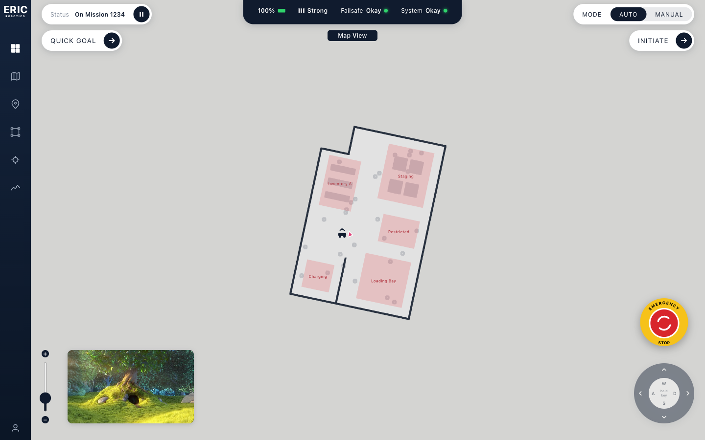
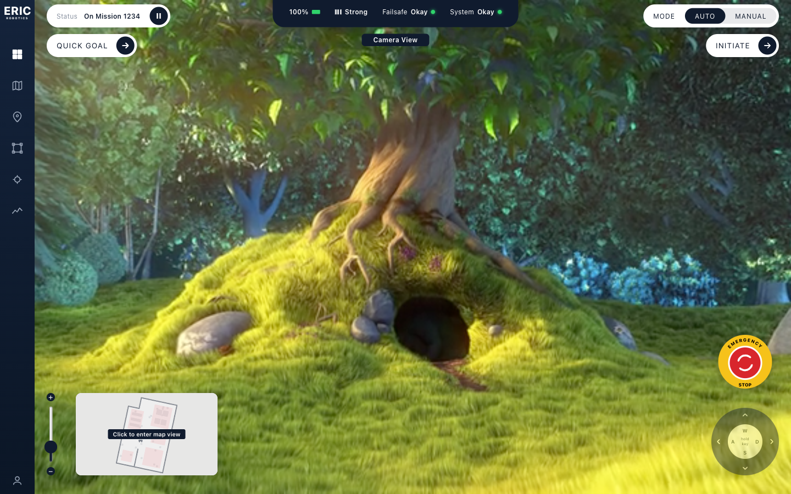
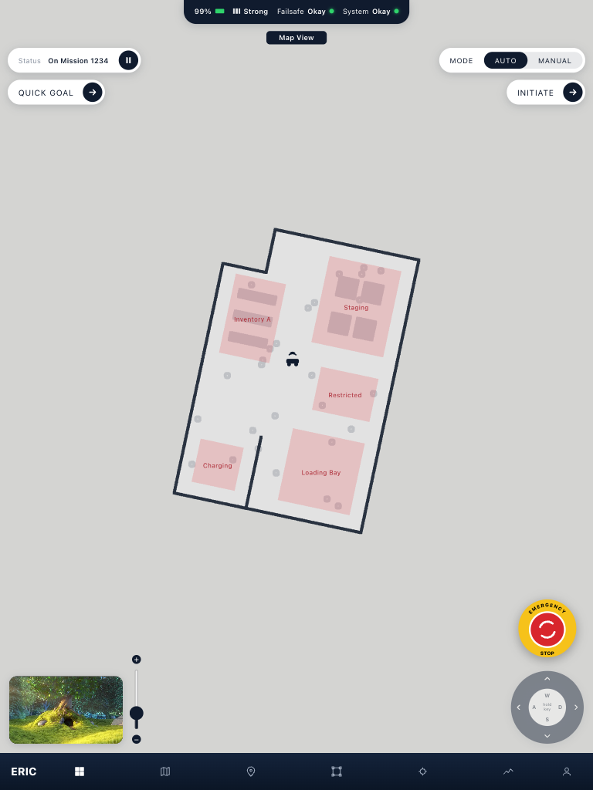
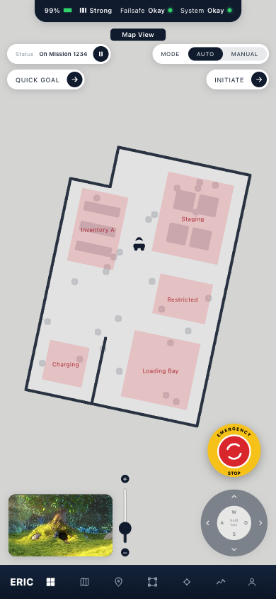

# Insight.IO dashboard

A self-hosted rebuild of ERIC Robotics' `Insight.IO` robot-ops dashboard: a live map view and a camera view
that swap between a main stage and a picture-in-picture, with mission controls, teleop, and an emergency stop.
Built with React 19, Vite, TypeScript, three.js (react-three-fiber) and zustand.

| Desktop (map main) | Desktop (camera main) |
| --- | --- |
|  |  |

| Tablet 768 | Phone 390 |
| --- | --- |
|  |  |

A short screen recording (AUTO, then MANUAL driving with WASD, back to AUTO) is in [docs/demo.webm](docs/demo.webm).

## Run it

Requires Node 20.19+ (what Vite 8 needs).

```sh
cd web
npm install
npm run dev          # http://localhost:5173
```

Other scripts: `npm test` (Vitest), `npm run build` (typecheck + production build), `npm run lint`,
`npm run assets` (regenerate the map assets).

Everything works offline with no backend: the robot replays a route over a point-cloud map.

## Using it

- **Swap views**: double-click the picture-in-picture (or its hover chip) to swap map and camera. Swaps within
  500 ms of each other are ignored so a double-click flips once.
- **Map**: mouse wheel or the +/- slider zooms, drag pans. **Quick Goal** arms the map; click to drop a goal pin.
- **AUTO / MANUAL**: AUTO follows the route. MANUAL drives the robot with held **W A S D** or the on-screen pad
  (the pad and keys do nothing in AUTO). Returning to AUTO rejoins the route at the nearest point.
- **Pause** holds the robot. **Initiate** switches to AUTO and resumes.
- **Emergency stop** pauses, forces MANUAL, zeroes the command and locks mode, pause, initiate and the pad.
  Pressing it again unlocks the controls but does not resume; the operator must press Initiate.

## Optional: ROS 2

The dashboard can stream from a ROS 2 robot through rosbridge instead of the static replay.

```sh
docker compose up --build          # rosbridge on ws://localhost:9090 + a simulated robot
cd web
VITE_ROBOT_SOURCE=ros npm run dev  # VITE_ROSBRIDGE_URL overrides the default ws://localhost:9090
```

| Topic | Direction | Type | Used for |
| --- | --- | --- | --- |
| `/odom` | robot to dashboard | `nav_msgs/Odometry` | pose and heading; staleness drives the signal indicator |
| `/battery_state` | robot to dashboard | `sensor_msgs/BatteryState` | battery (`percentage` is 0..1) |
| `/auto_drive` | dashboard to robot | `std_msgs/Bool` | heartbeat, true only while running in AUTO |
| `/cmd_vel` | dashboard to robot | `geometry_msgs/Twist` | MANUAL drive, and zero velocity while paused (sent whenever `/auto_drive` is false) |

The robot should latch `/auto_drive`, so a pause or e-stop still holds if the dashboard stalls or disconnects. The
bundled sim (`ros/sim_robot/sim_robot.py`) does this: it follows the route while the flag is true, drives from
`/cmd_vel` while it is false (a stale command counts as zero), and rejoins the route at the nearest point.

## How it is built

```
web/src
  data/    RobotSource interface; StaticSource (route replay) and RosSource (rosbridge over a WebSocket)
  state/   zustand store: view, mode, pause, zoom, pose, command, goal, e-stop
  hooks/   useRobotSource (picks the source), useTeleop (keys and pad to a drive command)
  views/   map/ (ortho r3f scene, point cloud, zones, DOM label layer, robot marker) and camera/
  components/  overlay UI, one component and stylesheet each
  styles/  design tokens and responsive.css
```

- **One data seam.** The UI only sees `RobotSource` (`start/stop/setPaused/setManual/setCommand`), so the static
  replay and ROS are interchangeable and selected by one env flag.
- **Both views stay mounted.** Swapping animates the two slots instead of remounting, so the WebGL context and the
  video keep running.
- **Labels are plain DOM**, positioned from the live scene each frame, and no fonts are fetched from a CDN, so the
  app works offline.
- **Responsive** uses a `--ui` scale per breakpoint (applied as a transform from each HUD corner), a bottom nav bar
  at 768 px and below, and larger touch targets on coarse pointers.

## Data and assets

- The map is a **synthetic**, seeded warehouse point cloud generated by `web/scripts/generate-warehouse.mjs`
  (`map.pcd` plus `layout.json` with zones, waypoints and bounds). It is not a real scan.
- The camera feed is a **stand-in**: a 10 s clip of *Big Buck Bunny* (c) Blender Foundation, CC-BY 3.0. Replace
  `web/public/assets/camera.mp4` to use your own footage.
- Telemetry in static mode is mocked (battery drains slowly; signal and status are fixed).

## Not covered

Real-device touch input and a ROS robot other than the bundled sim have not been tested.
